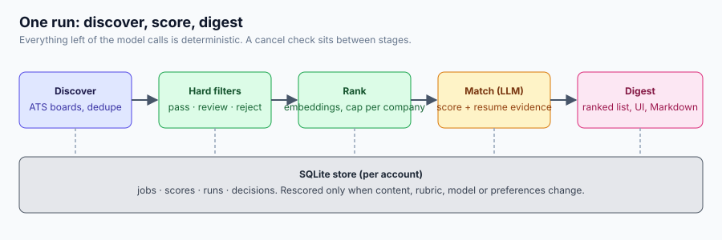
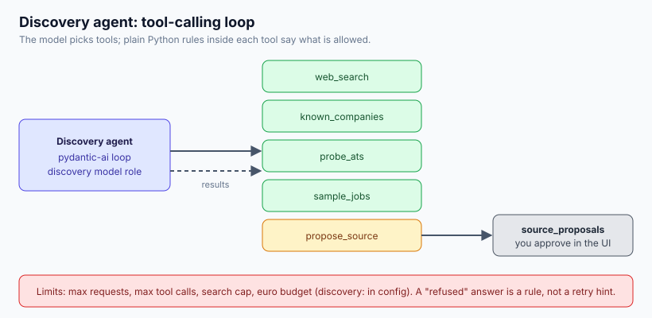

# Agent flow

Three small diagrams: how the code is layered, what one run does, and how the discovery
agent uses tools. Details live in [architecture](architecture.md).

## 1. Layers and ports

Drivers (CLI, API, UI) call use cases. Use cases talk to ports. Adapters implement the
ports, so a local model, a cloud provider or another job board is a swap, not a rewrite.
See [overview](architecture/overview.md).

## 2. One run

`discover`, then `profile`, `score`, `digest` (`usecases/pipeline.py`). Collection,
dedupe, filtering and ranking are deterministic; only the match step calls a model, and
every call goes through the PII redactor. See [pipeline](architecture/pipeline.md).

## 3. Discovery agent

The agent (`agents/discovery/agent.py`) is a `pydantic_ai.Agent` with five tools. It can
only propose boards; a person approves them. See [agents](architecture/agents.md).
