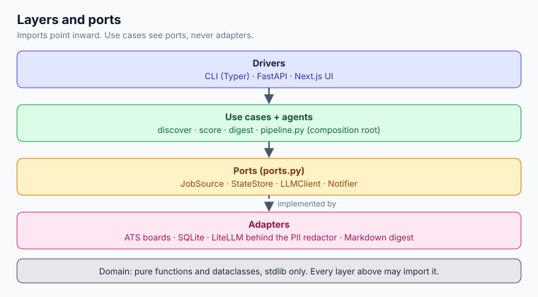

# Architecture — career-copilot

How the job-search agent is structured. **What** it does and **why** lives in
[`job_search_agent_plan.md`](job_search_agent_plan.md). Per-feature designs live in
[`superpowers/specs/`](superpowers/specs/), numbered in the order they were designed;
the [spec map](#spec-map) below says which spec owns which part. How the models are
hosted is in [operations](architecture/operations.md) and
[`../deploy/README.md`](../deploy/README.md).

For the order a run executes in and how the discovery agent calls its tools, see
[`agent_flow.md`](agent_flow.md).

## Read in this order

| Page | Covers |
|---|---|
| [Overview](architecture/overview.md) | hexagonal style, the four core ports, layers |
| [Agents](architecture/agents.md) | which steps are model-driven, their tools and output contracts |
| [Pipeline and data](architecture/pipeline.md) | collection ladder, dedupe, scoring, data model, application tracking |
| [Operations](architecture/operations.md) | model hosting, testing, runtime, security and PII, failure modes |

## Spec map

| Spec | Owns |
|---|---|
| 001-foundation | ports, layers, ladder, dedupe, hard filters, migrations |
| 002-scoring-and-digest | triage, match, score parts, digest |
| 003-frontend-onboarding | FastAPI boundary, Next.js UI, resume upload |
| 004-pii-gateway | redaction in front of every provider call |
| 005-preferences | preferences as the source of truth |
| 006-runs-and-observability | runs in the browser, run history, metrics |
| 007-review-and-recommendations | embedding ranker, review and recommendations screens |
| 008-local-model-runtime | backends, profiles, doctor |
| 009-source-discovery | discovery agent, company lists, more ATS vendors |
| 010-persistence-and-lifecycle | versioned CV, decisions, recycle bin, Notion |
| 011-agentic-recommendations | intent, curator, assistant chat |
| 012-chat-actions-and-run-feedback | chat tools that change preferences and dismiss jobs, search results reported back |
| 013-run-funnel | stage timings and the per-step funnel of a run |
| 014-cloud-backend | OpenRouter key in Settings, Local / Cloud / Hybrid presets, model catalog |
| 015-accounts | one folder and `jobs.db` per person, sign-in, `--user` on the CLI |
| 016-recommendation-improvement | stricter scoring, learning from saves and dismissals, repost memory, company-name lookup |
